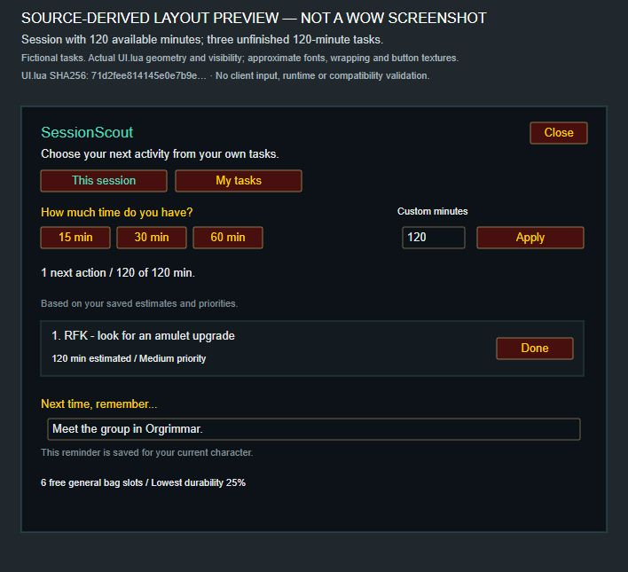

# SessionScout


Choose how much time you have. See up to three personal tasks that fit.

SessionScout turns your WoW to-do list into a plan for your next session. Enter
tasks with time estimates and priorities, choose your available minutes, and see
up to three unfinished tasks that fit. **Version 0.1.0 supports WoW Forever
1.60.1.** Estimates and completion are manual.

[Download on CurseForge](https://www.curseforge.com/wow/addons/sessionscout/files/9222143) ·
[Alternate download on GitHub](https://github.com/jdlarssen/SessionScout/releases/tag/v0.1.0-forever) ·
[Report an issue](https://github.com/jdlarssen/SessionScout/issues)

## Try the chosen-task tracker

Keep the task you chose on screen and mark it **Done** without entering `/scout`
again. These features are in the optional **0.2.0-alpha.4 experimental build** for
Forever 1.60.1. **Stable 0.1.0 remains the default download above.**

[Download the tracker alpha on CurseForge](https://www.curseforge.com/wow/addons/sessionscout/files/9268483)
and follow the [short setup and trial guide](docs/TRY_TRACKER.md).
Back up your addon files and saved data before testing; keep SavedVariables when
updating. Once installed:

1. Open `/scout`, then **My tasks**, and **Choose** an unfinished task.
2. Close Scout. Its compact tracker keeps your chosen task visible while you play.
3. Press **Done** on the tracker when you finish. **Undo** restores the task;
   **Choose next** lets you pick another without a slash command.

Completion is manual, and Scout never chooses your replacement task. The optional
book-guide link opens a separately installed Librarian Books Forever journal.
See the [test scope and remaining checks](docs/TRACKER_TESTING.md), including
tracker placement, reload restoration and the new reset timer.

[Tell us how the tracker worked in your session](https://github.com/jdlarssen/SessionScout/issues/new?template=tracker_feedback.yml).

## Interface preview

[](docs/media/sessionscout-0.1.0-session-preview.png)

*Source-derived preview of 0.1.0 with fictional, manually entered tasks.
One saved task fits a 120-minute session. Fonts and button textures are
approximate; this is not an in-game screenshot or a calculated gear recommendation.*

An [earlier in-game image of alpha.2](docs/media/sessionscout-30-minute-plan-forever-20261012.jpg)
shows the previous layout with fictional tasks.

## Install

1. Download `SessionScout-0.1.0-forever.zip` from
   [CurseForge](https://www.curseforge.com/wow/addons/sessionscout/files/9222143)
   or [GitHub](https://github.com/jdlarssen/SessionScout/releases/tag/v0.1.0-forever).
2. With WoW closed, extract its `SessionScout` directory into your Forever
   `Interface/AddOns` folder. The current beta uses `_classic_beta_/Interface/AddOns`.
   The resulting path must contain `SessionScout/SessionScout.toc` directly.
   Keep your SavedVariables when updating.
3. Start the game and enable SessionScout in the AddOns menu.
4. Enter `/scout` or `/sessionscout`.

Installation and updating through the CurseForge app have not been verified;
use the manual installation steps above.

## Use

1. Open **My tasks** → **+ New task**. Enter a name and estimated minutes,
   then choose priority, recurrence and completion scope. Press **Add task**.
2. Return to **This session**. Choose 15, 30 or 60 minutes, or enter 1–240 whole
   minutes in **Custom minutes** and press **Apply** or Enter. `/scout 45` also
   accepts a custom budget.
3. Mark a task **Done** when you finish. In **My tasks** → **Completed**, **Undo**
   makes it unfinished again.
4. Leave a **Next time, remember...** note for your next session.

**Nothing fits?** A task estimated at 120 minutes will not appear in a 90-minute
plan. Check the shortest unfinished estimate shown by the planner, then adjust
your available time or correct an inaccurate task estimate.

Task definitions are shared across characters. Editing or deleting a definition
affects every character; deleting requires a second click. Completion can be
shared across the account or tracked per character. The next-session note
belongs only to the current character.

## Features

- Up to three unfinished tasks within the chosen time budget.
- More high-priority tasks are preferred, then medium, then low; ties favor used time.
- One-time, daily and weekly tasks with manual completion and Undo.
- Tasks, completion, selected budget and reminders saved through WoW SavedVariables.
- General bag space and lowest equipped-item durability shown outside combat.
- No dependencies, external service, telemetry, advertising or chat broadcasts.

Daily and weekly completion uses reset times supplied by the game. If the
required reset API is unavailable, completion cannot be saved and the addon
explains why; it does not guess a reset schedule. One-time tasks remain available.

SessionScout does not discover game activities, detect quest completion, calculate
gear upgrades, time your activities or synchronize separate WoW accounts.

## Compatibility and validation

The release targets **Forever 1.60.1, interface 16001**. The UI and logic used in
0.1.0 passed 71 automated Lua model, mocked integration and Python tooling checks.
In-client checks on **1.60.1.70450** covered creating and editing tasks, cancelling
edits, Done/Undo, confirmed deletion, 120/90-minute budgets and invalid input.
Existing tasks, completion and character settings were preserved after `/reload`.
The release differs from the tested alpha.4 package only in its version strings.

Earlier checks on **1.60.1.70338** covered task operations, priority and recurrence
controls, completion scope, pagination, Unicode/pipe text entry, Escape, server-reset
timestamps and reload persistence. Scoped window-overlap checks also passed.
These checks do not replace testing across all supported workflows.

Actual daily/weekly reset crossings, second-character behavior, combat transitions,
manual window dragging, extreme UI scales, long sessions, full logout/restart
permutations and the complete bag/durability matrix remain unverified. Retail,
Classic Era and other Classic flavors are not supported by this package.
See the [client test record](docs/CLIENT_TESTING.md) and
[0.1.0 release record](docs/RELEASE_READINESS.md) for the test scope and package details.

Earlier [alpha.3](https://www.curseforge.com/wow/addons/sessionscout/files/9219847)
and [alpha.2](https://www.curseforge.com/wow/addons/sessionscout/files/9132600)
files remain available. Set **Show alpha files** to **Show** in CurseForge's
**Files** tab when looking for older versions.

## Feedback

Report reproducible bugs or describe a real play session in the
[issue tracker](https://github.com/jdlarssen/SessionScout/issues). Include the addon
and game versions, the steps taken and the result. Did suggestions help you
choose, did the tracker help you remember, or did setup and controls get in the
way? For the experimental tracker, use the
[short session feedback form](https://github.com/jdlarssen/SessionScout/issues/new?template=tracker_feedback.yml).
Finding that your usual method works better is useful feedback too.

Remove chat and personal information from screenshots. Please do not attach
complete SavedVariables files.

## Development

The latest opt-in **0.2.0-alpha.4 test build** is available on
[CurseForge](https://www.curseforge.com/wow/addons/sessionscout/files/9268483) and
[GitHub](https://github.com/jdlarssen/SessionScout/releases/tag/v0.2.0-alpha.4-forever).
The unchanged package was published as a CurseForge Alpha on 20 October 2026,
following its GitHub prerelease on 18 October. It fixes a daily/weekly completion
card that could remain visible after its recorded
server reset while the planner was closed. The visible card now refreshes every
30 seconds; hiding or undoing it stops that timer. It also includes the alpha.3
default-position adjustment, retaining existing saved positions. All 92 automated
checks pass, but the new timer has not been checked at an actual reset in WoW.
This remains an experimental Alpha; the default release above remains 0.1.0.

The earlier **0.2.0-alpha.2 test build** is available from
[CurseForge](https://www.curseforge.com/wow/addons/sessionscout/files/9243366) or
[GitHub](https://github.com/jdlarssen/SessionScout/releases/tag/v0.2.0-alpha.2-forever).
It adds a chosen-task tracker, direct
Done/Undo/Choose next actions, and an optional link to
[Librarian Books Forever](https://www.curseforge.com/wow/addons/librarian-forever).
To link a book task, edit it, choose **Guide: Library books**, save and choose
the task. **Book guide** then opens Librarian's journal. Librarian is installed
separately; it is not bundled or required for ordinary tasks. Guide links belong
to the current character, and opening the guide never completes a Scout task.
Scoped alpha.2 client checks on 18 October 2026 in Forever **1.60.1.70450** verified
choosing an existing task, closing and reopening Scout, direct Done/Undo and
opening Librarian 1.3.0 from the tracker. Existing tasks and completion records
were preserved after cleanup and reload. The default tracker overlaps the
quest/objective list and some bag slots in the tested layout. Two alpha.2 drag
attempts were inconclusive. The user subsequently confirmed manual movement in
the local, unreleased alpha.3 build, whose drag behavior is unchanged; its default
position still overlapped other controls in their layout. Drag the tracker to
suit your layout. Position restoration after reload remains unverified.
See the [tracker and book-guide test record](docs/TRACKER_TESTING.md) for the
remaining checks and limitations.

The earlier [**0.2.0-alpha.1 test build**](https://github.com/jdlarssen/SessionScout/releases/tag/v0.2.0-alpha.1-forever)
introduced manual task selection, also included in alpha.2: choose a suggestion
or use **Choose myself** to pick any unfinished task. A chosen task stays selected
for the current character until changed or completed. Longer estimates show a
budget warning without changing the task or the available time. **Use suggestions**
returns to the automatic planner. These controls are not in the 0.1.0 download
above. Alpha.1 was published before client testing of these controls; the scoped
checks above used alpha.2. The [manual-choice test plan](docs/MANUAL_CHOICE_TESTING.md)
records the earlier automated coverage. The default download remains 0.1.0.

```sh
lua5.1 tests/model_spec.lua
lua5.1 tests/integration_spec.lua
python -m unittest discover -s tests -p '*_spec.py'
python tools/build.py
```

The build creates a deterministic ZIP in `dist/`. Only addon source, its TOC and
license are packaged. See [build and installation tools](tools/README.md) for the
local Forever installer and [the changelog](CHANGELOG.md) for version history.

SessionScout is released under the [MIT license](LICENSE).
