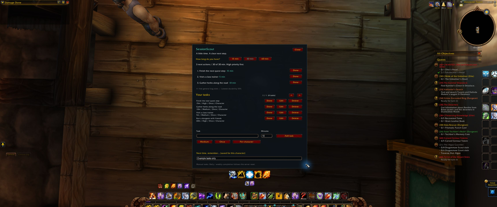

# SessionScout


Choose how much time you have. See up to three personal tasks that fit.

SessionScout is an early WoW Classic/Forever addon prototype for people who want a small,
deliberate plan for their next session. Its name and positioning are provisional.
**0.1.0 is available on CurseForge and GitHub for Forever 1.60.1.** It includes
the session/task-management redesign tested as alpha.4. Physical task operations,
120/90-minute budgets, invalid input and preservation of existing data after
reload passed on 17 October in Forever 1.60.1.70450. The release differs from
that tested build only in its version strings. Its CurseForge Release file was
verified publicly available on 17 October at 20:04 Europe/Oslo.

[Download 0.1.0 on CurseForge](https://www.curseforge.com/wow/addons/sessionscout/files/9222143) ·
[Alternate download on GitHub](https://github.com/jdlarssen/SessionScout/releases/tag/v0.1.0-forever) ·
[Source](https://github.com/jdlarssen/SessionScout) ·
[Report a reproducible issue](https://github.com/jdlarssen/SessionScout/issues)

[](docs/media/sessionscout-30-minute-plan-forever-20261012.jpg)

Alpha.2 in the Forever client, with fictional example tasks; this image predates
the Custom minutes control. Open it at full size to read the planner. Estimates
and priorities are entered manually; the 60-minute dungeon stays outside this
30-minute plan.

## Use

1. Download `SessionScout-0.1.0-forever.zip` from the
   [CurseForge file page](https://www.curseforge.com/wow/addons/sessionscout/files/9222143)
   or the [GitHub release](https://github.com/jdlarssen/SessionScout/releases/tag/v0.1.0-forever).
   With WoW closed, extract its `SessionScout` directory into your Forever
   `Interface/AddOns` folder (the current beta uses `_classic_beta_/Interface/AddOns`).
   The resulting path must contain `SessionScout/SessionScout.toc` directly.
2. Start the game and enable SessionScout in the AddOns menu.
3. Enter `/scout` (or `/sessionscout`).
4. Open **My tasks**, choose **New task** and enter its estimated minutes,
   priority and recurrence. Choose whether
   completion is shared across the account or tracked separately per character.
5. Return to **This session**. Choose 15, 30 or 60 minutes, or enter 1–240 whole minutes in **Custom minutes**
   and press **Apply** or Enter. `/scout 45` also accepts a custom budget.
6. Complete tasks manually. Daily and weekly completion expires at the reset
   time supplied by the game. Undo reverses a completion for the applicable scope.

Task definitions are shared across characters; “Per character” refers to their
completion. Editing or deleting a definition affects every character. The
“Next time” note belongs only to the current character. Delete needs a second click.

## What it does

- Recommends at most three unfinished tasks within the chosen time budget.
- Prefers more high-priority tasks, then medium, then low; ties favor used time.
- Saves tasks, completion and a personal reminder using WoW SavedVariables.
- Shows general bag space and lowest equipped-item durability outside combat.
- Uses no external service, telemetry, advertising, chat broadcasts or dependencies.

It does not automatically detect quest completion, recommend game content, time
your activities, or synchronize between separate WoW accounts. Time estimates are
your own. If the weekly-reset API is unavailable, weekly tasks cannot be marked
complete until it is available; the addon does not guess a reset date.

## Feedback

Use the [issue tracker](https://github.com/jdlarssen/SessionScout/issues) to report
a reproducible bug or describe a real play session. The templates distinguish
technical errors from whether the addon helped after setup effort, and whether
you chose to use it again. Reports that it did not help are useful too.

Use fictional task names and remove chat or personal information from optional
screenshots. Please do not attach complete SavedVariables files.

## Compatibility and validation

The release targets **Forever 1.60.1, interface 16001**. Actual client checks on
**1.60.1.70338** passed for task creation/editing/deletion, completion/undo,
priorities and budgets, pagination, and reload persistence of tasks, completion,
budget and a Unicode note. Daily and weekly completion stored server-reset
timestamps. Physical Unicode/pipe text entry, cancelling an edit and Escape were
also checked. A task-metadata display defect found in the client was fixed and
visually verified.

Alpha.3 adds the custom-budget field and clearer no-fit messages. Its new-control
rendering, keyboard entry and focus behavior remain unverified in the actual
client. Alpha.3 installation was recorded on **1.60.1.70374**. The development
alpha.4 was subsequently installed on **1.60.1.70450**. A follow-up on 17 October
resolved the initial input-delivery problem: the control tool was clicking below
its targets. With corrected coordinates, physical create/edit/cancel,
complete/undo, confirmed deletion, 120/90-minute budgets and invalid input passed.
One reload preserved all 11 original tasks, completion records and character
settings. The disposable task was removed. See the
[scoped follow-up](data/alpha4-input-validation-20261017.json); it does not certify
every client interaction or establish that the product is useful to other players.

Alpha.2 adds a window-ordering correction: the planner raises as one window when
opened, and periodic refreshes do not change foreground order. Scoped overlap
checks with the separately corrected local GearEvidencePilot passed on the same
client. The already-visible pilot and exposed-planner click cases also passed
in a follow-up on 12 October. Manual dragging remains unverified; see the client
test record for the exact checks. The pilot is not
included in this release, and the alpha.1 tag and ZIP remain unchanged.

This is a scoped release, not full compatibility certification. Actual daily/weekly
reset crossings, second-character behavior, combat transitions, extreme UI scales
and long-session behavior remain unverified. Retail, Classic Era and other
Classic flavors have not been validated or packaged as supported releases.
See the [client test record](docs/CLIENT_TESTING.md) for methodology and the
remaining checks. The temporary QA addon was removed and the user's original
account and character data were restored and independently hash-verified.

The published alpha.3 passed 62 automated Lua model, mocked integration and
Python tooling checks. The alpha.4 source used for 0.1.0 passed 71. These support
logic and packaging validation and do not replace actual client checks.

The current public CurseForge file is **0.1.0, Release, Forever 1.60.1**.
The [previous alpha.3](https://www.curseforge.com/wow/addons/sessionscout/files/9219847)
and [alpha.2](https://www.curseforge.com/wow/addons/sessionscout/files/9132600)
remain available; set **Show alpha files** to **Show** in the website's **Files**
tab when looking for those older versions.
The 0.1.0 Release showed **Approved** at 13:37 Europe/Oslo on 17 October, while
public checks at 13:37 and 13:59 returned **404**. At 20:04, the ordinary public
page showed the correct file, Release channel, Forever 1.60.1 and a download link.
See the [submission record](data/curseforge-release-0.1.0-submission-20261017.json).
Use the website download and manual installation above. Actual Forever-app
installation/update support remains unverified; public availability does not
establish successful app installation, adoption or popularity. The release
decision and publication status are recorded in [Release readiness](docs/RELEASE_READINESS.md).

## Development

```sh
lua5.1 tests/model_spec.lua
lua5.1 tests/integration_spec.lua
python -m unittest discover -s tests -p '*_spec.py'
python tools/build.py
```

The build creates a deterministic ZIP in `dist/`. Only addon source, its TOC and
license are packaged. See [build and installation tools](tools/README.md) for the
guarded local Forever installer. `tools/observe_rank.py --help` describes the optional
single-page ranking observer; unavailable observations are recorded as unknown.

See [research](docs/RESEARCH.md), [project status](STATUS.md) and the
[provisional listing draft](docs/CURSEFORGE_LISTING.md). No ranking or download
claims should be made without fresh evidence from the actual published project.

## Local product experiment

[`experiments/GearEvidencePilot`](experiments/GearEvidencePilot/README.txt) is a
separate RFK gear-evidence experiment for a level 30 Enhancement Shaman on
Forever. It reads equipped items and two candidate items from the client,
explains stat tradeoffs under two dated fixed-weight models, and exposes source
limitations. It is not included in the SessionScout package or published on
CurseForge. See its [validation record](experiments/GearEvidencePilot/TESTING.md).

Read the [Ferine Leggings comparison](docs/GEAR_COMPARISON_EXAMPLE.md) for one
verified stat tradeoff, the two fixed-model calculations and what remains unknown.
No installation is needed to read the example.
