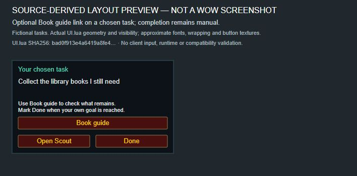

# Chosen-task tracker and book guide — 0.2.0-alpha.2

Experimental build for Forever 1.60.1, interface 16001.
The [GitHub prerelease](https://github.com/jdlarssen/SessionScout/releases/tag/v0.2.0-alpha.2-forever)
was published on 18 October 2026.
Scoped client checks on 18 October 2026 are recorded below, including an unresolved
tracker-placement issue and checks that remain outstanding.
The default public client-tested release remains 0.1.0.

*Source-derived layout preview with a fictional task, not an in-game screenshot.
Fonts, wrapping and button textures are approximate. This shows Scout's optional
Book guide action, not Librarian's journal or detected collection progress.*

## Use

1. Choose an unfinished task and close Scout. A compact tracker keeps its title
   visible. Drag its background to suit your layout; the default position can
   overlap other controls. See the version-specific movement checks below.
2. Use **Done** when your goal is reached. **Undo** restores and reselects that
   task. **Choose next** opens the picker, or a new-task form if none remain.
   No next task is chosen automatically. The completion card lasts only until
   dismissed or the UI is reloaded; completion itself remains saved.
3. For a library-book task, install and enable
   [Librarian Books Forever](https://www.curseforge.com/wow/addons/librarian-forever)
   separately. If WoW does not discover a new addon on reload, restart the client
   at a convenient time and check the AddOns list.
4. In Scout, edit the task, click **Guide: None** to select **Guide: Library books**,
   and save. Choose that task. **Book guide** is available on its card and tracker.
   The journal opens and Scout moves out of the way. This binding is per character.

Librarian supplies its own book catalogue, map markers and progress detection.
It uses quest completion and item counts, with manual corrections and some
unconfirmed mappings/locations. Check its displayed evidence when needed;
neither bag absence nor opening the guide proves a Scout task is complete.
Scout does not import checkmarks from a browser or infer a target from the task
name. A goal can be a subset of books or a reward tier; **Done** remains manual.

## Automated evidence

On 18 October 2026, 89 checks passed: 15 model, 55 mocked WoW integration and
19 Python tooling checks. Lua 5.1 syntax was checked. Coverage includes closing,
login/reload restoration, Done/Undo/next, unavailable reset times, missing identity,
future saved-data versions, explicit guide binding, cancel/unlink/delete, character
isolation, missing/malformed/failing companion and successful journal opening.
Source-derived HTML/SVG layouts are approximations, not client screenshots.

[Source CI](https://github.com/jdlarssen/SessionScout/actions/runs/39119703126)
passed for commit `68a53db955243a1ec7d60443e443f88451cfb6b7`. The 59,023-byte
release ZIP matches that commit's addon files and has SHA-256
`73c5dc86456ead1a957b44b8fdce1773f1b8aa75578cbc2423e3348ee6b28cde`.
GitHub's uploaded asset digest matches the local package. No verification download
was needed. These checks do not establish player adoption or client compatibility.

The integration targets the public `Librarian:OpenJournal()` entry point inspected
in [Librarian v1.3.0](https://github.com/thoriphes/Librarian/releases/tag/v1.3.0).
No Librarian code, data, assets or libraries are redistributed in SessionScout.

## Client checks — 18 October 2026

Tested the alpha.2 addon files from commit
`68a53db955243a1ec7d60443e443f88451cfb6b7` in Forever **1.60.1.70450**, with
Librarian **1.3.0** already loaded, at a 3440 × 1440 display resolution.

- Choosing an existing unfinished task from **My tasks** worked. Closing Scout
  showed its tracker, and **Open Scout** returned to the chosen-task card.
- **Done** on the tracker showed the completed-task card with **Undo** and
  **Choose next**, without choosing a replacement. **Undo** restored and
  reselected the unfinished task. **Choose next** was visible but was not clicked.
- Saving **Guide: Library books** in the editor added **Book guide** to the tracker
  and main card. Clicking it on the tracker opened the actual Librarian journal.
  The journal showed a missing book in the current zone, four books in bags and
  the next reward. This verifies the handoff and visible journal content, not the
  accuracy of every collection record. Opening it did not complete the Scout task.
  The main-card guide action was visible but was not clicked.
- The temporary guide link was removed. **Use suggestions** cleared the chosen
  task and hid the tracker. After a final `/reload`, the account SavedVariables
  file was byte-identical to the baseline: all 11 task definitions and all six
  completion records were preserved. The original 159-minute budget, empty note
  and welcome state were unchanged. The only character-file additions were an
  empty guide table and a tracker-position record at the same default location.

**Placement limitation:** the default tracker overlapped the quest/objective list
and some bag slots in this layout. Two native drag attempts moved the cursor but
did not visibly move the tracker. These alpha.2 attempts were inconclusive: they
do not establish a dragging defect or count as successful movement or
position-restoration tests.

### Subsequent user report — local alpha.3

After installing the local alpha.3 build and resetting its position, the user
confirmed they could move the tracker manually wherever they wanted. Alpha.3
changes the default position and leaves drag behavior unchanged. Its default
position still overlapped bags/objectives in their layout, so manual placement
remains necessary there. This report confirms movement for that local build and
setup; it does not establish a successful alpha.2 drag test, position restoration
after reload or a default placement suitable for every layout.

Screenshots and raw saved-data snapshots are kept privately because they contain
chat and character information. Only the sanitized results are published here.

## Remaining client checks

- Verify a manually changed position surviving reload, with placement that leaves
  essential controls visible. Check selection restoration on reload. The alpha.2
  native movement check remains inconclusive; alpha.3 movement is user-reported.
- Click **Choose next** and exercise the picker, including the no-tasks state.
- Open the book journal from the main card. Validate book progress against known
  collection state; opening a journal alone does not establish detection accuracy.
- Verify missing/disabled Librarian gives a readable message and preserves the
  selected task. Check small UI scales, combat transitions and other characters.

Preserve saved data. Do not mark these client checks passed from mock results.
